<p align="center">
  <picture>
    <source media="(prefers-color-scheme: dark)" srcset="assets/hero-dark.svg">
    
  </picture>
</p>

<h1 align="center">Nabu: open source, set up for you</h1>

<p align="center"><b>Turn a project that sits on GitHub into one people can contribute to.</b></p>

<p align="center">
  <a href="https://github.com/ilien-dev/nabu/releases"></a>
  <a href="LICENSE"></a>
  
</p>

<p align="center"><a href="#how-the-setup-works">How it works</a> · <a href="#what-every-pull-request-gets">Pull requests</a> · <a href="#install">Install</a> · <a href="#after-the-setup">After the setup</a> · <a href="#commands">Commands</a> · <a href="#limits">Limits</a></p>

---

**Nabu is an agent skill that gets a GitHub repository ready for outside contributors.** You run
one command and answer three questions. It protects the default branch, fixes how branches and
PR titles are named, writes CONTRIBUTING.md, a short PR template and a contribution skill for AI
agents, and makes versions and releases automatic. From then on you review pull requests and
merge them; the rest runs by itself, in any language. A script does the work, not the agent's
reading of a prompt, so every repository ends up identical.

## How the setup works

<p align="center"><picture>
  <source media="(prefers-color-scheme: dark)" srcset="assets/readme/how-dark.svg">
  
</picture></p>

1. **Nabu reads the repository first.** `detect` finds the default branch, the version files, the
   CI job names and any older setup, so it only asks what it cannot see.
2. **You answer three questions.** Do changes need measurements before and after? What kind of
   release is it (Claude Code plugin, npm, desktop, mobile, library or none)? Is it a website kept
   as a submodule of a main project?
3. **The script writes everything.** `init` stores your answers in `.github/repo-rules.json`,
   `render` writes the managed files from fixed templates, and `verify` runs the PR check against
   valid and invalid sample PRs.
4. **One setup PR, then the settings.** The files go in on a `ci/` branch. Once you merge it, the
   agent runs `github` for you, which applies the ruleset, squash-only merges, auto-merge, secret
   scanning and private vulnerability reporting. You only click merge.

## What every pull request gets

<p align="center"><picture>
  <source media="(prefers-color-scheme: dark)" srcset="assets/readme/features-dark.svg">
  
</picture></p>

- **Named branches and titles.** Branch `<type>/<1-5 lowercase words>` and a title
  `<type>: <summary>` with the same type, at most 72 characters. Types: feat, fix, perf,
  refactor, docs, test, build, ci, chore, style, revert.
- **A description you can review fast.** What, Why, How, Risk, Evidence and a Checklist, each
  with a character limit. Measured projects add a Measurement section with numbers.
- **One check that enforces it.** `PR rules` runs from the default branch, so forks are checked
  without approval and a PR cannot change the rules it is judged by.
- **A skill for AI contributors.** Agents that contribute load `uncontributing`, which walks
  them through the same rules and runs the check before they open the PR.
- **One change per PR.** Squash merge only, one approval from anyone with write access, and a
  new push dismisses it.

## Install

In Claude Code:

```text
/plugin install nabu --marketplace ilien-dev/nabu
```

Then run `/nabu:setup` in the repository, or ask your agent to "get this repo ready for
contributors". For a repository that already follows the standard, `/nabu:audit` lists every
difference and fixes them once you agree. Agents that read `.agents/skills` can use
`skills/nabu/` directly.

> [!IMPORTANT]
> You need Node 18 or later, `git`, and `gh` signed in with admin rights on the repository.

## After the setup

<p align="center"><picture>
  <source media="(prefers-color-scheme: dark)" srcset="assets/readme/use-dark.svg">
  
</picture></p>

Nobody writes a version number. On every push to the default branch,
[release-please](https://github.com/googleapis/release-please) reads the
merged titles: `feat` raises the minor number, `fix`, `perf` and `revert` the patch, and `!` the
major. Other types release nothing. It updates CHANGELOG.md, tags the release and keeps it a
draft until every build job succeeds, then publishes it as latest. A PR that touches files
users install has to use a releasing type, so a change never ships without a version.

Desktop and mobile builds, and npm publishing with trusted publishing, run from the same tag
when the project needs them. The details per release kind are in
[skills/nabu/references/versioning.md](skills/nabu/references/versioning.md).

## Commands

The plugin commands call one script, which you can also run yourself:

| Command | What it does |
|---|---|
| `detect` | Reports what the repository has today |
| `init --answers answers.json` | Writes `.github/repo-rules.json` from your answers |
| `render [--check] [--remove-obsolete]` | Writes or checks every managed file |
| `verify` | Tests the result against sample PRs and the workflow names |
| `scan-secrets` | Scans every commit for tokens before going public |
| `github [--dry-run] [--public]` | Applies the GitHub settings and the ruleset |
| `audit` | Lists every difference from the standard |

Each one runs as `node skills/nabu/scripts/nabu.mjs <command> --repo <dir>`.
`skills/nabu/references/` explains the answers file and the PR format.

## Limits

- It works on GitHub only, through `gh`, and needs admin rights on the repository.
- The release token, an npm trusted publisher and app signing keys are yours to create; Nabu
  gives you the exact steps.
- The setup PR has to be merged by an admin: the new `PR rules` check cannot judge the PR that
  adds it.
- It never makes a repository public without a clean secret scan and your explicit yes.
- It does not adapt the standard per repository. A missing feature belongs in the templates, so
  every repository gets it.

## Tests

```bash
node tests/run.mjs
```

The tests never reach real GitHub: `gh` goes through a stub.

## Contributing

Branches, the PR format and its limits are in [CONTRIBUTING.md](CONTRIBUTING.md).

## License

MIT, see [LICENSE](LICENSE).
